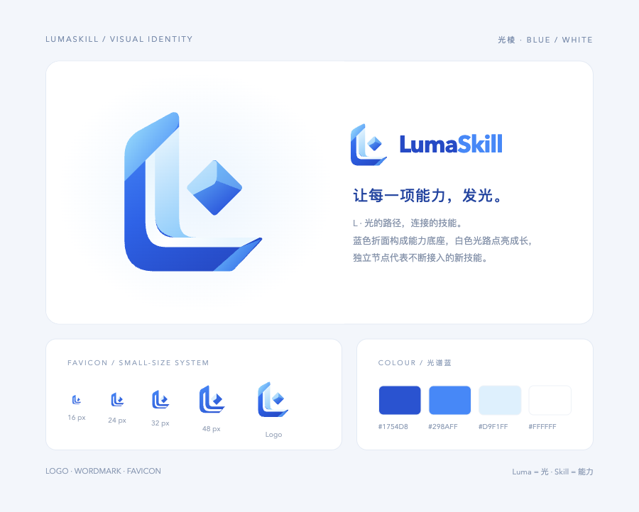

# LumaSkill 标识

设计语义：Luma 取作光与明亮，Skill 代表可连接、可成长的技能。统一对外品牌写法为 **LumaSkill**；GitHub 仓库 slug 保留 `lume-skill`。

## 光棱 L

蓝色折面构成 L 形能力底座，白色光路沿转角贯通，独立菱形代表不断接入的新技能。参考的是折叠材质与轻盈感，主体轮廓为重新设计的 L 形。

- `lumaskill-mark.svg`：主标识，可无限缩放；`lumaskill-mark.png` 为 512×512 透明 PNG。
- `lumaskill-wordmark.svg`：横向字标；跨系统展示可使用 964×256 的 PNG，避免字体差异。SVG 字标优先使用 Avenir Next，回退到 Segoe UI / sans-serif，不分发字体文件。
- `lumaskill-favicon.svg`：小尺寸简化版，保留 L、白色光路和技能节点。
- `favicon-16.png`、`favicon-32.png`、`favicon-48.png` 与三尺寸 `favicon.ico`：浏览器图标。
- `apple-touch-icon.png`：180×180 白底触屏图标。

主蓝 `#1754D8`，亮蓝 `#298AFF`，冰蓝 `#D9F1FF`，白色 `#FFFFFF`。图形不依赖背景、动画或外部字体。登录页和工作台沿用原有紧凑布局；字标使用几何感较强的字体，正文不更换。设计方向为“光学折面”，DFII 14（表现4、适配4、实现4、性能4、维护风险2）。

本目录为标识源资产。Skill Eval 的 `frontend/public/brand/` 和 favicon 文件保留所需副本，保证子项目独立构建；修改时同步对应副本。

概念通过 imagegen 探索，生产文件采用干净的 SVG 重建；PNG 和 ICO 从 SVG 导出。概念提示词摘要：`LumaSkill；光与连接的技能；折叠光学飘带构成大写 L；白色内嵌光路；右上独立菱形节点；钴蓝、亮蓝、冰蓝、白色；透明背景；简洁科技感；小尺寸可辨。` 最终矢量版本修正了生成图的边缘与小尺寸细节。

本目录资产采用 MIT，见 [LICENSE](LICENSE)。
