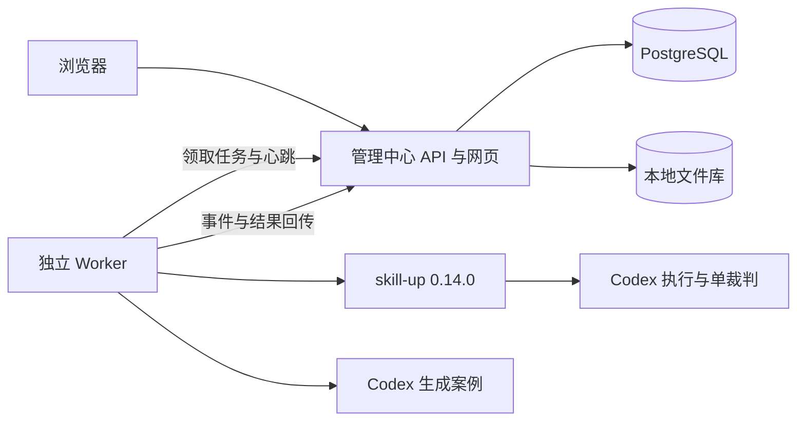

# 完整方案

日期：2026-10-23。本文为设计基线，保留原需求及接口示意，不代表当前实现进度。2026-10-24 源码已合 main，本机主链路及 CI 通过，目标 Docker 真实模型另验，见 [完整交接](AGENT-HANDOFF.md)。实际接口已统一到 /api/tasks（以 kind 区分），接入码有效期已实现为 10 分钟；以下历史接口表与 30 分钟示例不作为实施指令。

## 1. 目标与边界

让没有企业内部账号和工具的用户，通过网页管理本地 Skill 和案例，使用独立 Worker 完成真实评测。资源和结果由用户自己部署的系统保存。

已确认约束：

- skill-up 固定为 0.14.0，唯一主引擎为 Codex；默认每个案例一种裁判。
- 模式为“标准评测”，范围为“全部案例”，不提供模式或范围选择器。
- 有案例优先使用；无案例才询问是否自动生成；用户可以持续维护案例库。
- 保留四个页面：Skills、评测集管理、评测记录、系统配置。Worker 并入系统配置。
- 独立 Worker 只需要一个接入授权码；没有项目、小队、成员等配置。
- 优先本地库、合理默认值、简短引导和整套一键启动。
- 不继承财务专用字段、术语、命令或内部服务依赖。

一期不支持回放、录制采集、远程同步、Git 发布、多引擎、多裁判、自动修复、版本对比分析页、跨 Skill 共享案例、智能调度、多租户或组织权限。不提供 MCP 服务配置及真实外部业务工具接入页面；依赖这些能力的案例明确标为不支持，不能改写成已验证的普通案例。

## 2. 主要交互

### 2.1 首次使用

1. 启动服务，浏览器打开本机地址。
2. 设置一个管理员密码。
3. 检查内置 Worker 或接入独立 Worker，选择可用的 Codex 模型配置。
4. 上传自己的 Skill，或使用合成示例。模型尚未配置时仍可浏览示例、管理文件，但不能声称执行成功。

初始化不要求填写数据库、项目、队列、成员或内部地址。检查结果区分“CLI 已安装”“配置存在”和“实际模型请求成功”；只有用户点击连接测试才发起模型请求。

### 2.2 上传 Skill

- 支持 ZIP 和网页目录上传；多文件 Skill 保持相对路径。ZIP 为跨浏览器通用入口。
- 自动识别唯一根目录及 SKILL.md；多个候选根时提示用户选择或整理文件，不任意取第一个。
- 名称、描述、声明版本优先从文件读取；版本缺失时给出本地修订号，不要求补齐无关字段。
- 同名 Skill 提示“新增版本”或“创建独立 Skill”；显示名称不作为数据库身份。
- 完全相同内容按摘要识别；同一 Skill 下不重复创建相同内容版本。
- 上传只保存和校验文件，不执行包内安装、脚本或指令。

### 2.3 案例匹配与发起评测

匹配依据为系统内稳定的 Skill ID，而不是名称的模糊匹配。

| 当前状态 | 页面行为 |
| --- | --- |
| 有启用且有效的非空评测集 | 直接展示该集、版本、案例数；用户确认后运行 |
| 有多个评测集 | 默认选择该 Skill 的默认集；允许切换，不混合不同集 |
| 只有草稿或未启用版本 | 引导用户校验、启用或修复已有内容，不当成“无案例”自动生成 |
| 没有任何非空案例集 | 询问“自动生成”或“上传评测集”；取消后不生成、不调用模型 |
| Skill 新版本沿用旧案例 | 显示案例基于哪个 Skill 版本编写，允许复用，不自动重建 |

点击开始时冻结 Skill 版本、评测集版本、模型配置标识和内容摘要。双击或请求重试只创建同一个任务。入队时没有可用 Worker 应明确显示“等待 Worker”，允许取消。

### 2.4 案例生成

生成由 Codex 配合 skill-upper 的案例编写指令完成，skill-up CLI 负责结构校验和执行。生成使用经审阅并固定版本的上游指令资产；不引入观察器、自动反馈采集或 Skill 自我修复流程。

- 用户明确确认后才创建生成任务；与评测任务共用任务队列和 Worker。
- 提供目标 Skill 内容与用户的可选补充要求；不得将中心凭据、历史私有报告或其他 Skill 文件加入上下文。
- 实施默认值：首次目标生成 5 个案例，覆盖主要能力、边界和失败条件；可在生成前修改目标数量。实际结果与目标不符时明确显示，不伪造补齐。
- 生成器只能写候选案例工作目录；被测 Skill 快照保持只读，并在结束后校验摘要。
- 生成结束后校验，保存新草稿，展示内容及问题；用户可以编辑、启用后再评测。
- 重新生成始终创建新草稿；不自动覆盖已有版本、切换默认版本或开始评测。
- 生成失败保留错误分类和可用草稿，不产生通过记录；重试由用户发起新尝试。

### 2.5 评测集维护

每个评测集只归属一个 Skill，一个 Skill 可有多个评测集，其中一个为默认集；每个集有一个启用版本。

- 普通表单编辑案例名称、任务、预期条件、裁判类型与标准；支持新增、删除和排序。
- 高级入口编辑 YAML、脚本及附件，保存后统一校验。可视化编辑不能丢弃它不认识的字段；不能无损转换时改用源码编辑并提示原因。
- 评测集支持原生 skill-up ZIP/目录包，以及 evals.json 转换导入。保留上传原件，预览转换结果后保存。
- 原生布局为 evals/eval.yaml、evals/cases/、evals/fixtures/。容器中的 Skill 与案例由系统在任务目录装配，不修改上传原件。
- 草稿可以不完整；非空、通过校验的保存版本才可启用和执行。运行任务只能引用不可变版本。
- 编辑已有保存版本先创建草稿，保存新版本；启用新版本不修改旧报告。并发编辑通过版本号冲突提示，禁止静默覆盖。
- 未引用的草稿可删除；已引用版本只归档，保持旧报告可追溯。归档不等于删文件或级联删除历史任务。
- 导出包含用例、断言和必要 fixtures，不包含模型密钥、Worker 凭据、运行日志或中心配置。

### 2.6 标准评测与全部案例

标准评测是 Codex 在隔离任务工作区实际完成案例，再按配置判定；不含任何录制回放。

- 以启用评测集的入口清单为准执行所有案例；不根据 smoke、full 等旧策略抽样，也不使用名称筛选隐式排除案例。
- 冻结并显示案例清单。包内未被入口引用的案例文件在校验时列出，启用前要求处理，防止“全部”与用户预期不一致。
- 一期不提供“禁用案例但仍算全量”的开关；不需要的案例应从新版本移除。
- 每个案例最多一个 judge，可为 rule_based、script 或 agent_judge；expect 作为前置条件，不算额外裁判。
- 优先确定性断言。需要语义裁判时仍使用 Codex，默认复用评测模型连接，但开启独立裁判会话。
- 被测会话不安装 skill-upper，不接收裁判标准答案和判分脚本；裁判上下文仅包含该案例所需证据。包内主动泄露答案的情况在校验中提示，不能声称仅靠文件名实现完全隔离。
- 不做 with/without Skill 基线对比、自动多轮稳定性实验和自动失败重跑；不静默启用导入包中的这些选项。
- 原生格式兼容不等于支持上游全部功能。非 Codex、多裁判、回放、MCP/远程运行配置、跨目录资源等超出范围的输入应给出字段级问题；可以保存原件或草稿，但不能偷偷删配置后执行。

### 2.7 结果与报告

任务执行状态和评测结论分别保存：

- 执行状态：QUEUED、RUNNING、CANCEL_REQUESTED、SUCCEEDED、FAILED、CANCELLED、INTERRUPTED。
- 结论：PASSED、FAILED、INCOMPLETE，任务未形成结果时为空。
- Agent 输出不满足断言：评测已完成但结论 FAILED，不是系统执行失败。
- 任一预期案例因技术原因未完成、跳过或缺少裁判结果：结论 INCOMPLETE，不显示全量通过。已失败案例仍逐条保留。
- 只有冻结清单中全部案例形成有效 PASS，才能显示“全部通过”。

保留 skill-up 原始结果、HTML 和系统摘要。报告记录各版本、案例列表、判分方式、耗时、退出信息和可取得的数值用量；没有用量或价格来源时显示未提供，不估造成本。实际模型无法从可信返回中识别时显示“未核实”，不得拿请求参数代替实际身份。HTML 报告以受限 iframe/独立下载方式展示，不允许上传内容在中心同源执行脚本。

## 3. 技术架构

保留 React + TypeScript、FastAPI、PostgreSQL。资源包和报告保存本地持久化文件目录，PG 保存元数据、版本与任务；一期不使用 Redis、消息中间件和外部对象存储。



中心不执行被上传的 Skill。Worker 仅通过 API 访问被分配的任务资源，不直连 PG、不共享中心整个文件库。内置 Worker 与独立 Worker 使用同一实现、同一协议。

### 3.1 模块和数据实体

| 实体/模块 | 责任 |
| --- | --- |
| skills / skill_versions | 稳定身份、展示信息、不可变源码包与摘要 |
| evaluation_sets / set_versions | Skill 归属、默认集、草稿与启用版本、案例清单和校验结果 |
| tasks / attempts | generate/evaluate 两类任务、冻结输入、租约、进程状态、幂等和结果 |
| workers / enrollment_codes | 接入、撤销、能力、心跳、授权码兑换 |
| artifacts / events | 包、报告、增量进度、摘要和任务归属 |
| settings / credentials | 单管理员配置；模型连接与凭据分开保存 |

内容采用 SHA256 标识。文件落盘成功并校验后才登记有效引用；未完成上传使用临时区，启动维护检查可清理过期临时文件，但不自动清理用户历史资源。文件与数据库双写失败不得留下可执行的半成品版本。

### 3.2 拟定 API 边界

接口名称为开发设计，实际 OpenAPI 在实现时生成并验收。

| 范围 | 主要接口 |
| --- | --- |
| 初始化与会话 | /api/setup、/api/session、/api/settings |
| Skill | /api/skills、/api/skills/{id}/versions |
| 评测集 | /api/evaluation-sets、/{id}/versions、/{version}/validate、/{version}/activate、/{version}/export |
| 案例生成 | POST /api/generations，GET /api/generations/{id} |
| 评测 | POST /api/evaluations，GET /api/evaluations/{id}，POST /{id}/cancel |
| Worker 管理 | /api/workers、/api/worker-enrollment-codes |
| Worker 协议 | /api/worker/enroll、/claim、/heartbeat、/attempts/{id}/events、/artifacts、/complete |

创建任务接受幂等键及 Skill/评测集版本；相同键相同请求返回原任务，不同请求返回冲突。所有下载和结果提交检查 Worker、attempt、租约代次与内容摘要。任务包固定版本，中心不会在 Worker 执行中偷偷改写配置。

### 3.3 Worker 生命周期

用户仅需安装/启动 Worker 并输入一个授权码。授权码编码中心可达地址和随机一次性凭证，不包含管理员密码或模型密钥。远程用户的中心地址由部署者配置一次；不能把 localhost 授权码当成远程可达地址。

1. 中心创建短期、一次性授权码；默认有效期 30 分钟，可以重新生成。
2. Worker 兑换接入身份，自动保存长期连接凭据（文件仅本机用户可读）。中心仅存凭据摘要。
3. Worker 报告系统、架构、skill-up/Codex 版本及可用配置标识。不得回传模型凭据内容。
4. Worker 主动轮询领取匹配任务，领取在 PG 事务中完成；一期只按最早可执行任务和基础能力匹配。
5. 执行期间心跳并增量回传事件；完成后上传结果清单，中心校验后持久化终态。

默认心跳 10 秒、领取间隔 3 秒、租约 60 秒。断连不立即重新派发；租约过期后旧执行不可继续提交新终态。Worker 在无法续约时停止任务子进程；中心标记中断。手动重试创建新 attempt，保留旧结果；不自动重新执行可能仍存活的任务。

租约未过期时，网络恢复可续传原事件和结果；完成响应丢失时可查回或幂等重传。租约已经过期时，旧报告只能作为迟到诊断保留，不覆盖当前状态或新尝试。

取消排队任务直接结束；取消运行任务向 Worker 下发指令，终止任务进程组，确认后记录取消。成功与取消竞争用数据库状态版本裁决，终态不反复覆盖。Worker 被撤销后不得领取或提交；本地任务在下一次鉴权/续约失败时停止。

### 3.4 Codex 与 skill-up 适配

- skill-up 固定 0.14.0，下载校验、镜像及版本检查一致。
- Codex 精确版本由开发阶段真实兼容性验证确定并写入兼容矩阵；不编造已验证版本，不自动覆盖用户已有安装。
- 生成调用 Codex；评测调用 skill-up 原生 Codex adapter，尽量不保留旧系统的内部启动器或模型别名。
- 适配 whole-suite validate、list-cases、run、事件日志、result.json 和 HTML。具体参数以 0.14.0 的 help/schema 为准，不仅靠字符串替换旧版本号。
- 模型默认值来自经过实际检查的用户连接；选定后冻结到任务。未配置模型时禁止使用隐含的内部模型默认值。
- 宿主机优先使用用户显式选择的现有 Codex 登录/连接。内置 Worker 的凭据通过引导设置，保存在专用凭据存储；不挂载用户整个 HOME。
- 如中心代管内置 Worker 模型凭据，使用实例密钥加密保存，密钥位于独立受限持久化文件；仅向被授权 Worker 提供所需配置，不放进任务产物或可导出的评测集。
- 用户只配置一组默认模型连接；Agent 裁判复用连接但独立会话。生成、被测执行和裁判都不接收无关任务的凭据和历史上下文。

### 3.5 执行与文件边界

所有运行使用任务专用临时目录，源版本不可变；不同案例使用上游正常工作区生命周期，不使用共享宿主机 --workspace 复用业务目录。脚本 judge/setup 只在用户明确发起执行后由 Worker 运行，导入和静态编辑时不运行。

宿主机 Codex 默认使用 workspace-write 沙箱，不自动降级到绕过审批及沙箱。Compose 内置 Worker 使用非 root 进程和限定挂载，不挂 Docker socket、不挂中心数据目录。容器中 Codex 的实际兼容性属于首阶段门槛：默认模式无法运行时明确失败并调整受控执行方案，不静默放宽权限。

任务目录隔离和单 Worker 容器不等于不可信多租户的强隔离；一期定位单管理员自用。持久化 Worker 接入凭据与被测工作区分离，子进程环境按白名单传递。向用户展示实际运行环境，不宣称实现了不存在的完全断网或多租户沙箱。

上传/解包拒绝路径逃逸、符号链接、重复冲突路径、绝对路径和解压超限；导出校验相同边界。初始可配置上限：压缩包 100 MiB、解压后 500 MiB、文件 10,000 个；超限明确拒绝，不截断内容。

## 4. 页面组织与默认值

| 页面 | 首要内容 | 次要内容 |
| --- | --- | --- |
| Skills（首页） | 上传、选择 Skill、开始评测 | Skill 版本与默认评测集 |
| 评测集管理 | 当前案例、编辑、保存、校验、启用 | 来源、版本、导入导出、重新生成 |
| 评测记录 | 最近任务、状态、结论、报告 | 固定版本、运行环境和诊断 |
| 系统配置 | Codex 连接与 Worker 状态 | 接入码、密码、存储及默认参数 |

主链路避免展示 backend、attempt、schema 等实现字段，排障详情按需展开。

实施默认值：

| 配置 | 默认 |
| --- | --- |
| 监听 | 127.0.0.1:8765；端口占用时提示修改，不擅自终止进程 |
| 并发 | 每 Worker 一个任务；每任务一个案例并发 |
| 范围 | 冻结评测集入口列出的全部案例，不抽样 |
| 判分 | 每案例单裁判；expect 可作为前置条件 |
| 基线对比/自动重跑 | 关闭 |
| 案例超时 | 上传包显式值优先，缺失时 300 秒；裁判时限单独计算 |
| 任务总时限 | 根据案例数与执行、裁判预算计算，加准备/上传余量；不得固定为小于子任务总预算的短时限 |
| 生成超时 | 初始 15 分钟，后续根据真实生成验收调整 |
| 存储 | 元数据 PG；文件持久化卷；历史资源不自动删除 |
| 模型 | 引导选定并检查的连接；不预填内部模型、不静默回退 |
| 新版本 | 不自动升级 skill-up、Codex 或已冻结任务 |

## 5. 部署和简化鉴权

发布目标是 `docker compose up -d` 启动 web/api、PostgreSQL、Worker。镜像内固定必需版本，首次启动自动迁移空库和生成实例密钥。安装 Docker/联网下载镜像属于运行前提，模型登录由引导完成。发布前使用源码构建路径验收，正式版另提供带版本及摘要的预构建镜像；不把尚未发布的镜像当成可用产物。

独立 Worker 提供版本化安装/启动入口：校验系统前提、安装到独立应用目录、提示输入授权码、自动检测 Codex。skill-up 安装不覆盖其他项目二进制；Codex 缺失时给出明确安装引导，兼容性失败不改写系统安装。优先支持 Linux x86_64 与 macOS arm64 的独立 Worker；Compose 在 Linux x86_64 和 macOS arm64 Docker Desktop 验收。Windows 原生 Worker 后置。

一个管理员密码和会话足够；无角色、负责人、二次输密码。保留密码哈希、登录限速、HttpOnly/SameSite Cookie、CSRF 和严格允许来源检查。首个管理员初始化只开放一次；非本机暴露时用一次性初始化口令限制抢注，部署前明确配置访问地址和 HTTPS。

备份覆盖 PG、文件库及需要恢复凭据的实例密钥；文档给出配套备份/恢复操作。数据库单独恢复不能宣称恢复完整。首次启动不得覆盖已有数据卷，版本迁移失败应停止并说明恢复方式。

## 6. 仓库与复用策略

```text
frontend/       网页
backend/        API、资源、版本、队列和会话
worker/         生成和评测执行器
examples/       完全合成 Skill、案例和报告
deploy/         Compose、镜像、安装入口
docs/           方案、开发、验收及使用文档
```

从现有评测中心提取通用报告、任务和版本校验思路；对认证、Skill 来源、队列与回放相关代码逐项归属。选择性迁移，不复制旧工作区后批量删除敏感文件。新库不含财务数据、内部部署配置、原始录制、旧 Git 历史、个人路径和真实账号。

不做通用插件框架；资源导入、Worker 协议与评测引擎保留清晰模块边界，后续第三方接入通过 API 增加。本期不为未来产品编写空实现。

## 7. 依据与待验证事项

已确认产品范围无需再次选择。以下是实现验证事项，不是默认扩大范围的许可：

- Codex 精确版本、登录方式和内置容器兼容性，第一阶段实测后固定。
- 0.14.0 报告、事件、裁判与退出码语义按真实样例核验，测试不能只验证自造 JSON。
- 自动生成案例质量须由合成 Skill 的已知正确/错误变体验证，生成通过 schema 不代表判分有效。
- 开源代码权属和第三方许可、GitHub 发布目标在公开前明确；本方案不代表已经取得公开授权。

上游依据（固定版本，2026-10-23 查阅）：

- [0.14.0 README](https://github.com/alibaba/skill-up/blob/v0.14.0/README.md)：引擎、运行环境和报告能力。
- [0.14.0 CHANGELOG](https://github.com/alibaba/skill-up/blob/v0.14.0/CHANGELOG.md)：评分语义变更；独立 judge.engine；多裁判共享工作区。一期只支持单裁判，不将新旧分数直接混比。
- [Writing Evals](https://github.com/alibaba/skill-up/blob/v0.14.0/docs/guide/writing-evals.md)：案例布局、配置和引擎版本检查；CLI 版本检查不代表登录验证。
- [CLI Reference](https://github.com/alibaba/skill-up/blob/v0.14.0/docs/guide/cli-reference.md)：整体校验、案例选择、事件与原始报告；一期全量运行不使用 include/exclude 过滤。
- [LICENSE](https://github.com/alibaba/skill-up/blob/v0.14.0/LICENSE)：保留上游许可和必要归属；本项目 LICENSE 在代码来源核对后确定。
