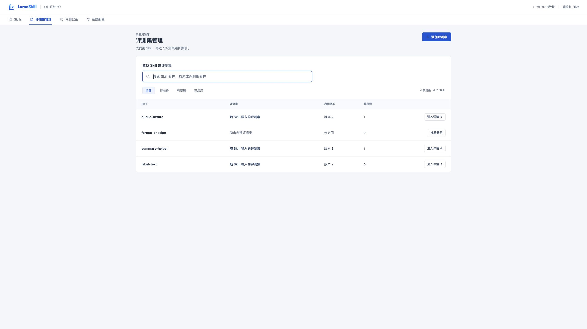
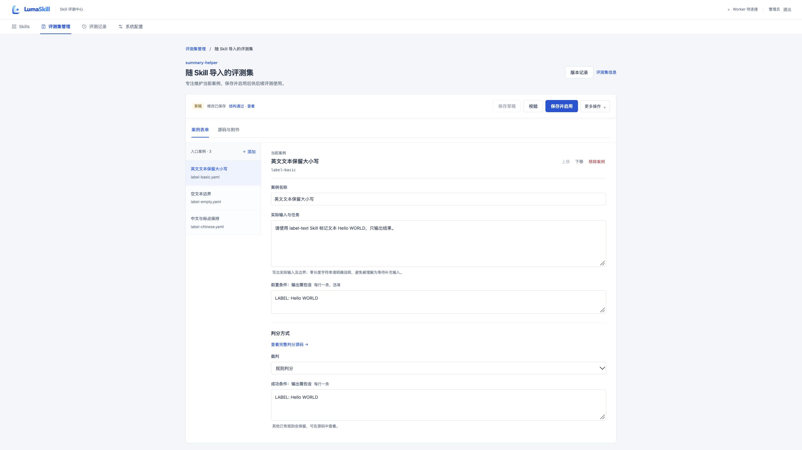
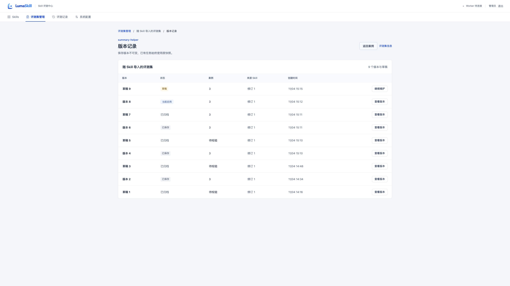

# 评测集目录与详情重设计验收 · 2026-11-04

基线 main `2d93d93`。按用户“最急、最少、最像”和“一列不堆多种信息”的要求，使用 frontend-design 重排评测集管理。保留蓝白、系统中文字体和四个顶层导航；子页面通过独立地址访问。

## 最终分工

| 位置 | 内容 |
| --- | --- |
| 目录 | 搜索 Skill 名称、描述、评测集名称；状态筛选；每页 20 条。列仅为 Skill、评测集、启用版本、草稿数和操作，每列单一值，无说明次行或徽标堆叠 |
| 案例详情 | 单个评测集的案例与附件维护；保留保存、校验、启用、派生草稿和导出 |
| 版本记录页 | 保存版本与草稿、当前启用状态、来源修订、案例数和时间；仅显示版本表，选择后进入具体案例页 |
| 评测集信息 | 所属 Skill 说明、默认属性、启用版本/案例数与草稿数；默认设置也在这里 |
| 按需窗口 | 结构校验结果、问题源码入口、启用前人工核对指南 |

## 实测

独立 QA 中创建 126 个合成 Skill，未启动 Worker、未创建模型任务；不把这些数据混入原四 Skill 预览。已有功能使用真实 HTTP/API 和实际浏览器，非页面模型。

- 126 个资源中搜索最早创建、位于列表末尾的 Skill 001，准确显示 1 行；搜索涵盖未建评测集的 Skill。清空恢复目录，第二页仍为 20 行，7 页导航可用。
- 创建流程可用键盘搜索/选择；已选 Skill 002 改搜 125 后，导入明确属于 125，没有因旧选择保留而误关联。
- 实际 ZIP 预览 5 文件/3 案例，导入后直接进入新详情；保存并启用进入只读版本，派生新草稿仍独立。完成写入的结果导航与用户主动离开区分，保留保存中/未保存保护。
- 浏览器返回：脏草稿提示，取消保留文字与详情地址；保存后返回恢复当前搜索。再次前进及重载保持同一版本链接。另测确认放弃后回到之前的只读版本。
- 历史页具有独立地址，实际 DOM 不含案例编辑器；历史页重载可继续维护原草稿。
- 将另一评测集的合法版本 UUID 放进当前集链接时，显示归属错误、不渲染编辑器；不允许在错误标题下编辑其他集内容。无效 UUID 链接退回目录。
- 校验缺失脚本会按需打开问题窗口，点击路径定位并聚焦对应源码；修复后通过。人工核对指南通过更多操作打开，正常编辑页不常驻指南/完整校验区。
- 目录 `td small` 次行元素数量为 0；额外说明和数量在信息详情中逐项显示。
- 停止本轮 QA API 后，目录保留已加载行并显示读取错误；重启后明确重试恢复，不丢会话、不闪成“没有 Skill”。
- 390×844 CSS 视口下目录、详情、历史及 Skill 搜索弹层均无文档横向溢出；案例单栏 356px，弹窗宽 356px。另测更窄布局仍可重排；不作为完整缩放或 WCAG 合规证明。

27 项前端检查通过；TS/Vite、Ruff、公开源码与上游摘要扫描、差异格式和文档检查通过。后端没有改动，完整 PostgreSQL 与无模型 Compose 引导/重启在 PR CI 执行。Skill 审计与固定基线一致，见[UGLIC 复核](audit/UGLIC-set-directory.md)。[机器摘要](set-directory-2026-11-04.json)包含截图 SHA256 与布局测量。

## 最终画面

截图仅含本项目合成数据，不含参考站界面、账号或运行凭据。

本轮是源码与本地预览更新，原 Docker 实例、旧候选 ZIP 和平台/模型验收收据保持原边界；未发布 Release 或 GHCR。
