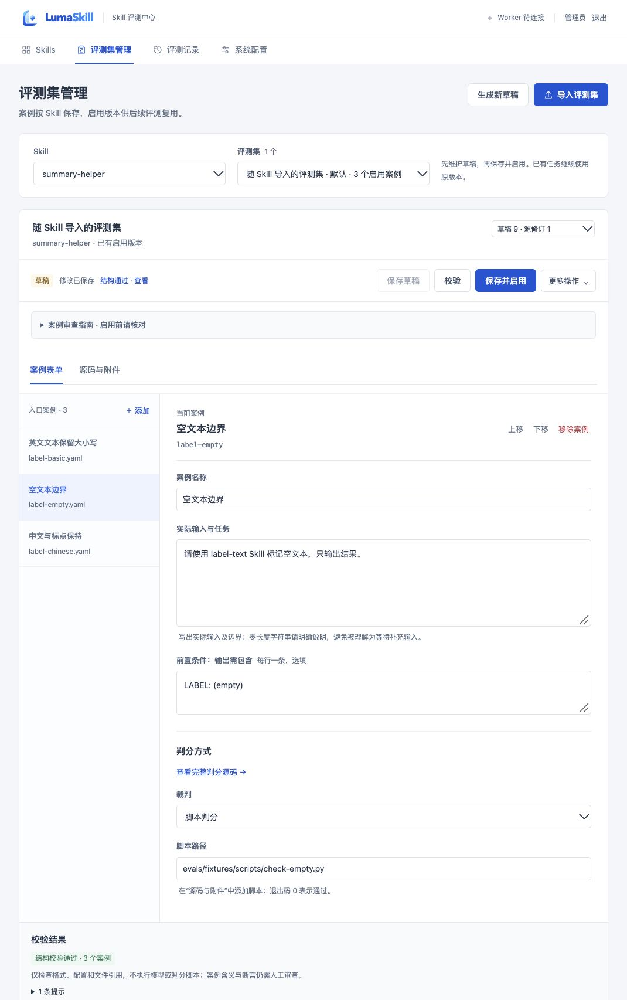

# 剩余界面建议验收 · 2026-11-04

基线 main `6fa138b`，接续上一轮 [工作台改进](ui-refinement-2026-11-04.md)。仅前端与文档，不改变数据库、冻结版本、全部案例、判分规则或调用策略。依旧蓝白主题、系统中文字体、四页结构；不新增包或视觉框架。

## 本轮补齐

- 保存新版本和派生草稿保留非首案例、表单/源码模式、文件；按正文相对视口位置恢复。手动切换资源不使用旧保存位置。
- 保存条显示待校验/结构通过/有问题，可直达校验区；错误文件路径是可操作入口，打开匹配源码并聚焦。异常 YAML 保留原内容并提供就近修复按钮。
- 未保存时导出明确为“上次保存的内容”；不自动保存或暗中包含编辑值。源码文件删除展示对象和影响，取消保留内容。
- 记录详情与列表支持明确的往返、焦点和定位；详情加载与日志读取失败可见，不将失败解释为 0 条。
- 弹窗关闭返回触发控件，默认保留；原控件消失则返回主内容。更多菜单支持 Esc、点击外侧和选择后关闭；键盘选中态与当前导航有语义。
- 辅助文字和状态标签提高对比度；增加跳到主要内容入口、缩放重排及减少动态效果偏好的支持。视口较矮时取消吸顶，避免操作条遮住正文。
- Skills 的在线提示改为“Worker 在线，可接收任务”，就近说明在线状态不代表真实模型调用已验证。

## 实际验证

| 场景 | 结果 |
| --- | --- |
| 非首案例、保存与启用 | 空文本边界持续选中；新启用版本的正文位置由 179.234px 到 179.375px，差 0.141px；保存提示、只读说明新增时阅读位置仍保持 |
| 源码模式派生 | label-empty.yaml 在新草稿中保持选中与源码模式；新编辑区取得焦点 |
| 校验到修复 | 合成草稿引用 missing.py，实际返回错误；点击错误路径聚焦对应 YAML 源码，改回已有脚本后再次校验通过，历史版本保留 |
| 删除与菜单 | 删除确认默认保留，7 次 Tab 焦点仍在对话框；Esc 后文件存在、无新增修改、焦点回删除按钮。更多菜单 Esc 回 summary，未保存导出含明确提示 |
| 记录导航 | 明确点击记录详情后焦点在任务详情，点击返回列表后焦点在任务列表；执行完成与判分未通过继续分开 |
| 390×844 | 四页 DOM 量测均文档宽 390，无横向溢出；表格在自身容器滚动 |
| 放大等效重排 | 四页 640×450 CSS 视口无横向溢出，模拟 1280 宽在 200% 下可用区域；不是实际浏览器缩放或合规认证 |
| 对比度 | 记录页 13 组可见样本为 4.95–6.37:1；只声明已抽测的文字/背景组合，不宣称全站 WCAG 合规 |
| 自动检查 | 23 项原前端测试通过、TS/Vite 构建通过；源码扫描、差异格式及文档检查通过。后端没有修改；完整 PG 与无模型容器检查由远程 CI 执行 |

数据、版本和任务均为隔离合成数据，本轮没有真实 Worker 或模型调用。浏览器视口已恢复；原 Docker 实例、现有候选包、正式 Release/GHCR 及原生 Linux x86_64 边界保持。完整机器摘要见 [JSON](ui-followup-2026-11-04.json)，审计见 [UGLIC 复核](audit/UGLIC-ui-followup.md)。

