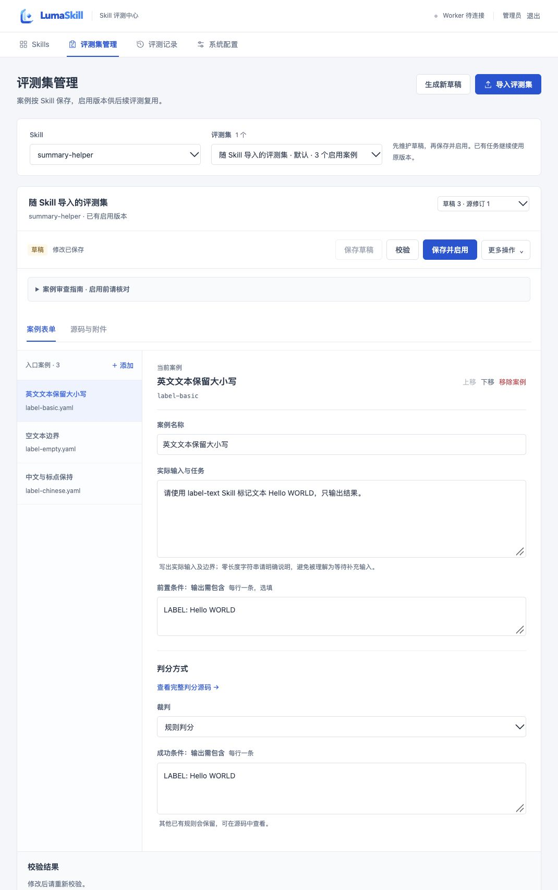
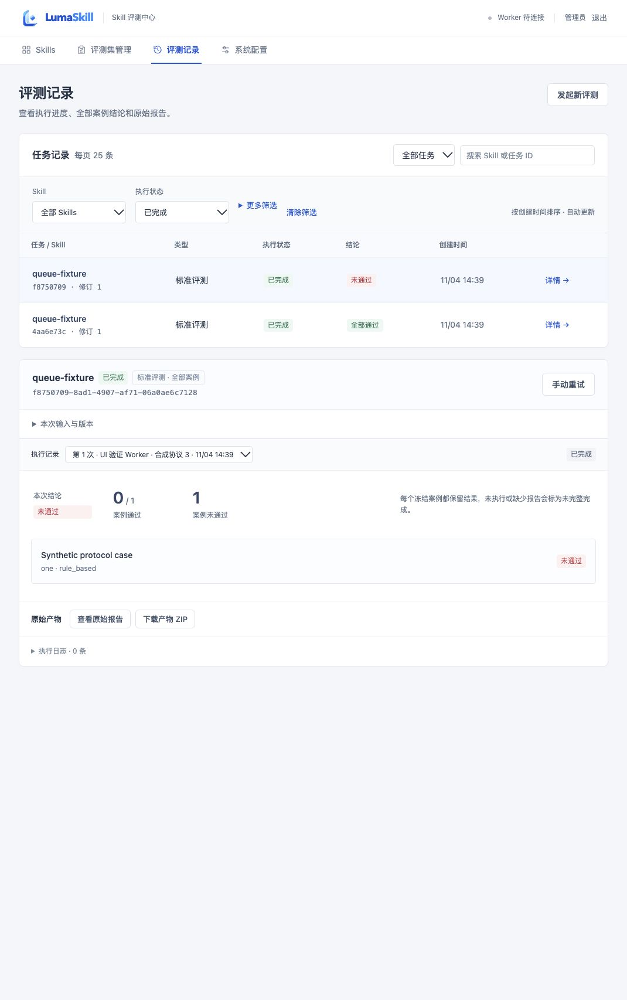

# 工作台界面验收 · 2026-11-04

基线 main `37cc002`，仅修改 `skill-eval/`。最终源码与远程 CI 以本轮 PR / Git 历史为准。使用独立原生 API、PostgreSQL、生产前端构建及合成资源，没有修改旧 Docker 实例、启动真实 Worker 或调用模型。原始数据与登录资料不进入仓库。

## 自动检查

- PostgreSQL 后端 59 项通过，0 失败、0 跳过；保留原有重复 ZIP 条目与 Starlette httpx 弃用两条警告。
- 前端 23 项通过；TypeScript、Vite 生产构建、Ruff、锁文件离线一致性、公开源码及第三方摘要检查通过。
- 首次测试因新检出目录缺少私有固定 skill-up 工具失败；补入已验证的 0.14.0 私有工具后通过，没有更改全局版本。
- 新增全量筛选回归：旧任务位于 26 条更新任务之后时仍可按状态找到；组合结论、Skill、时间端点和非法参数均覆盖。
- 新增事务回归：在 HTTP response.start 处用独立连接核对写入。修复前读取不到、测试失败；修复后读取到且通过。所有数据库依赖改为函数作用域，已安装包版本未变。

## 浏览器验收

| 场景 | 结果 |
| --- | --- |
| 未保存离开 / 切换 | 确认框提示；取消后文本保留；保存草稿后成功提示及内容一致 |
| 保存并启用 / 派生草稿 | 版本 2 为只读启用快照；从其派生草稿 3 并保存，不改变启用指针 |
| 状态与结论 | SUCCEEDED 筛选显示两条合成记录，PASSED / FAILED 分开；FAILED 结论筛选只剩一条，详情同步 |
| 日期与空结果 | 开始日 2099-01-01 无结果，不显示旧详情；清除恢复 |
| 安全确认 | 取消任务默认聚焦“保留任务”；Esc 保留 QUEUED，明确确认后才 CANCELLED；未执行显示 INCOMPLETE |
| 配置 | 四步引导、运行环境折叠；离线与已配置登录分别表达，未点击真实连接检查 |
| 中心中断 / 恢复 | 停止本轮 API 后显示错误并保留 10 条记录；恢复后轮询自动读取，无需重载 |
| 小屏布局 | 实际 CSS 390×844，文档宽度 390，无横向溢出；案例单栏 356px，列表最大 190px，保存条 sticky；配置步骤两列。通过 DOM 布局及控件检查，未将合成设备截图作为视觉证据 |
| 桌面最终构建 | 最终生产包重新加载，编辑与记录页截图核对，审查提示折叠、保存与筛选入口可见 |

以下截图只含本项目合成数据，没有发布参考站点截图或源码。最终编辑页与记录页：

机器摘要与截图 SHA256 见 [JSON 收据](ui-refinement-2026-11-04.json)。UGLIC 和 Skill 审计见 [审计复核](audit/UGLIC-ui.md)。本轮源码合并不覆盖 11/03 固定候选包，不构成新的真实模型、原生 Linux x86_64、正式 Release 或 GHCR 验收。
