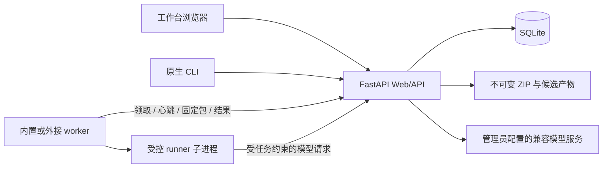

# Open Skill Manager 项目交接与复盘

> **T02/T04 本地接续，2026-10-25**：当前开发版本 **0.3.2.dev1**，schema 4。14 个固定样例（含一个保留许可的公开真实快照）、批量审计/修复工具、人工复核摘要绑定、专用 CI 与源码/wheel/sdist 验证已实现。158 项回归和 14 例真实 Web/worker 静态批量检查通过，模型调用 0。可迁移静态回执位于 `regression/baselines/`。**T02 的真实模型与人工语义结果仍待实际配置**，本轮用户已授权最多 256 次调用；给出的 Harness 工具/权限补丁未包含连接字段，用户稍后提供实际配置。**T04 的 GitHub runner 矩阵尚未触发**，当前只完成本地实现与验证，不发布包/镜像。后续入口见 [REGRESSION.md](REGRESSION.md)、[CI.md](CI.md)。
>
> **2026-10-25 本地接续**：从合集仓库 `eca5e69` 拉取，初始工作区为空，无旧 `.local/` 证据或运行配置。本轮优先实现 T01；开发版本为 **0.3.2.dev0**，schema 仍为 4。疑似凭据包在 runner 和 Web 端阻断模型与自动修复，详见 [目标隐私策略](TARGET-PRIVACY.md)。下文 0.3.1、80 项及真实模型证据均为历史基线；本轮验证单列于 [VALIDATION.md](VALIDATION.md)。未发布公共包或镜像，未修改内置独立 Skill。
>
> 快照日期：2026-10-24。运行版本 **0.3.1**，代码基线 **f130611**，SQLite schema **4**。本文件为发布基线之后的交接资料，不会重打或替换已经验收的 0.3.1 发行物。
>
> GitHub 同步：2026-10-25，仓库 [Songhonglei/lume-skill](https://github.com/Songhonglei/lume-skill)，项目目录 `skill-manage/`。下列短提交号属于迁入前本地开发历史，本仓库以一次源码快照迁入，不包含那些 Git 对象。
>
> 阅读顺序：先看第 1、8、9、12 节，再按工作项查架构、代码和证据。同机接手另读本机 `.local/HANDOFF-LOCAL.md`；该文件不进入 Git，不包含密码或密钥值。

## 1. 先接住这几个结论

- 首期 **P0–P6 已完成既定范围验收**。主链路是：注册固定版本 → 审计 → 选择问题并授权 → 候选修改 → 新会话完整复审 → 服务端门禁 → 登记新版本 → 下载。
- 当前是可运行的自托管小团队工作台：Python / FastAPI、SQLite、本地不可变 ZIP、原生 CLI 和 Compose、独立 worker、普通 HTML/CSS/JS 前端。
- 最近一次代码回归 **80 项通过**；Linux arm64 原生 wheel 与 Compose 均有真实模型完整闭环。macOS arm64 原生、升级、重启和备份恢复也有证据。
- 最后一个主链路故障已解决：完整模型请求曾超过 40 秒；0.3.1 执行调用等待 90 秒、worker 等待平台 100 秒。任务总时限、评分、必要证据和发布门禁没有放宽。
- 原交接检查确认 **T01：被审目标文件的脱敏覆盖不足**。0.3.1 的短口令、无引号环境变量值可原样保留；2026-10-25 本地接续已新增检测与整包阻断，见 [新策略及边界](TARGET-PRIVACY.md)。它与“平台模型 Key 不发 worker、不入上下文”的既有保护是两项不同问题。
- 干净源码及文档同步到 `Songhonglei/lume-skill` 根目录 `skill-manage/`；安装和开发命令先进入该子目录。本项目未配置专用 CI，也未发布公共包或镜像；现有 Skill Eval 工作流不代表本项目已被覆盖。
- 原交接轮只核对项目、做小范围静态检查及合成脱敏复现，没有重跑收费模型验收，也没有修改运行代码。GitHub 迁入轮的复查另见 [同步审查](reviews/GITHUB-SYNC-UGLIC.md)；不将历史真实模型验收说成本轮新结果。

### 状态怎么理解

“已完成首期”对应当前计划与已验证环境。面向真实敏感资料、更大数据量、更多模型或广泛分发的下一轮门槛见 T01–T04。现有成功样例不证明任意 Skill 的业务语义正确，也不保证每个模型请求都会收敛。

## 2. 做到哪了

| 阶段 | 已交付内容 | 证据与边界 |
| --- | --- | --- |
| P0 基线与契约 | 新仓库、MIT、来源白名单、领域身份与状态契约 | 业务实现重写，无旧 Git 历史；保留内置审计 Skill 的上游许可证 |
| P1 安装与存储 | wheel/sdist、CLI、Web 初始化、四次 SQLite 迁移、原生后台进程、Compose、备份恢复 | Linux arm64 / macOS arm64；实际主要验证 Python 3.12.12 |
| P2 注册与权限 | ZIP/目录/公开 ZIP URL、冻结补填、不可变版本、预览下载、维护者与管理员 | 同版本同内容复用，异内容拒绝；共享只读，按 owner/admin 写入 |
| P3 执行基础 | 一次码、机器凭据/撤销、原子领取、租约/心跳、代次、取消、有限重试、冻结结果重传 | worker 只走 HTTP，不读 SQLite；外接 worker 在同机独立目录验收 |
| P4 审计 | 独立通用 Skill、静态与语义审计、逐规则结果、服务端重建报告/评分、模型代理、任务 UI | 真实 PASS/FAIL 正反例；静态满分仍不能声明完整 PASS |
| P5 授权修复 | 所选 finding 授权快照、受限候选读写、最多 3 轮、独立完整复审、原子登记、差异 UI | 真实文档/脚本缺陷修复；篡改、取消、越界、冲突、失权、重复提交反例 |
| P6 完整交付 | 两种 Linux 安装与完整闭环、macOS、升级/重启/恢复、产物一致性与文档 | 已通过；平台、模型和跨机器覆盖限制仍需保留 |

### 提交地图

| 提交 | 作用 |
| --- | --- |
| `af967c1` | 0.1.0 注册平台、原生安装和存储基础 |
| `add7542` | 0.2.0 独立 worker、有限执行、通用审计 |
| `4d1ccd9` | 0.3.0 授权修复、独立复审、发布门禁 |
| `f130611` | 0.3.1 模型超时修复、脱敏失败诊断、P6 验收完成 |

迁入源码来自本地 `10df1ca`，运行代码仍为 `f130611`；这些提交不在合集仓库历史中，不能在此直接 checkout。迁入只调整公开文档和首页入口，未修改运行代码。接手时用 `git log -1 --oneline` 获取实际文档提交，不将它误认为新的运行版本。

## 3. 产品边界和已经确定的选择

### 保持的方向

- 个人/小团队、自托管、团队共享 Skill 库，管理员和单一 Skill 维护者两类写权限。
- SQLite + 本地文件，单个 Web 实例打开一个数据目录；默认全平台执行并发 1。
- Web 与 CLI 使用同一配置、初始化、迁移和存储契约；原生运行不依赖 Docker。
- worker 是管理员认可的可信执行机器，处理平台分配的包；首期不承接不可信第三方算力。
- 原包保留，修改只发生在候选；平台只运行固定受控检查器，不运行被审 Skill 的脚本、安装钩子或任意测试。
- 前端沿用企业工作台：灰白背景、蓝色操作、紧凑顶栏与表格。用户明确不接受暖白纸张、橙色的自由发挥。
- 用户偏好：中文、简洁，最急的内容优先，同类操作归组，减少手动填写。Shell 用 `python3`，检索优先 `rg`。

### 首期未包含，不能当成漏实现

企业 SSO、多租户、PG/MySQL、评测平台、内部系统兼容、自定义 Hub 连接器、多品牌 Agent CLI 执行器、任意目标代码执行，以及高并发调度。增加这些能力要先明确新范围和验收，不因名字类似就接回原内部平台。

## 4. 架构与执行过程



模型配置与 Key 留在 Web 端。runner 的模型调用通过平台代理；worker 不能指定任意模型 URL、Key、system prompt 或自定义工具。图中的候选文件与结果传递均经固定任务 API；worker 不直接打开平台数据库或 objects 目录。

### 注册

1. 检查 ZIP 成员路径、类型、大小和数量；不 extract、不执行目标。
2. 自动识别唯一 wrapper 根目录及 SKILL.md 元数据。需要补填时冻结已下载原包，绑定用户和临时令牌，不重新下载 URL。
3. 同时固定原包摘要和规范化内容摘要，再登记不可变版本。新版本不会默认切换 current。

### 审计

1. 固定 version / content / artifact / ruleVersion / depth / modelRevision 输入 manifest。
2. worker 原子领取 attempt，以代次与租约校验后下载包、核对双摘要，启动独立 runner。
3. 固定静态检查；完整审计再提供受限证据。小文件可在受控预算内一次提供，大文件继续分块，只对实际提供的区间计覆盖。
4. 模型输出每条活动规则的 pass/fail/review。遗漏、重复、状态与 findings 不一致或证据未读全均不能完整 PASS。
5. 服务端重建分数、finding 身份、报告原文与 SHA-256；同一事务保存审计台账和报告，冻结结果重传不重新评分。

### 修复和登记

1. 用户选择明确 finding ID，冻结来源报告/包、目标版本、路径、最多轮数、自动登记和 current 选项。
2. 编辑工具仅限候选内的 `read_file/write_candidate/delete_candidate/finish_edit`；写入要求当前内容摘要。版本调整在复审前完成。
3. 每轮先冻结候选，再使用全新模型消息做全量独立复审，并核对授权范围。独立指“新上下文”，当前并非不同模型的双模型投票。
4. 服务端再次验证：完整 PASS、零 ERR、无必要待复核、所选规则已清、scopeSatisfied、候选双摘要、权限仍有效、最新版本/current 基线未变化、任务成功且未取消。
5. 在 `storage.lock + SQLite 写事务` 内登记 plannedVersionId、最终审计与 findings；失败不能形成半登记版本。

## 5. 接手代码从哪里读

路径相对仓库根目录。先读入口与契约，再按实际工作项看实现，避免从长前端文件或旧来源材料倒推当前行为。

| 路径 | 职责 / 修改注意 |
| --- | --- |
| `src/skill_mng/cli.py`、`lifecycle.py` | CLI、初始化和进程管理；保持文件锁、PID 实例身份与子进程清理 |
| `app.py`、`auth.py` | 注册 API、会话、CSRF/Origin、账号权限与 UI 静态资源 |
| `packages.py`、`fetch.py`、`imports.py` | ZIP 检查、公开 URL 固定 IP、冻结元数据补填 |
| `registry.py` | 不可变版本与原子登记；`register_in_transaction` 供修复最终事务复用 |
| `db.py`、`migrations/001…004` | SQLite schema 4、WAL、外键、编号迁移；只能向前新增迁移 |
| `tasks.py` | 领取、单并发、租约/代次、取消、过期恢复、有限重试、机器凭据 |
| `execution_api.py` | 审计/任务/worker API、固定模型工具与 schema、模型失败事件 |
| `worker.py`、`worker_client.py` | HTTP worker、心跳、runner 生命周期、冻结结果交付；不接入 SQLite |
| `models.py` | 管理员模型配置、两次实际能力检测、兼容 API、稳定失败分类 |
| `runner.py`、`auditing.py` | 证据覆盖、逐规则一致性、冻结审计、服务端接收校验 |
| `repair_api.py`、`repairs.py` | 授权、候选/复审回执、`_gate`、`_publish` 与事务边界 |
| `repair_runner.py`、`repair_packages.py` | 候选受限编辑、新会话复审、版本调整、脱敏与差异 |
| `resources/skills/skill-deep-audit/` | 独立可用的审计 Skill；规则、静态引擎、路径 AST 检查器与上游来源 |
| `static/app.js`、`index.html`、`style.css` | 无前端构建工具链；列表、文件、任务、审计、修复和设置 |
| `backup.py` | 一致性备份、空目录恢复、摘要/数据库校验、会话/机器撤销 |
| `tests/` | 单元/协议/实进程测试；`smoke_*.py` 为独立安装与真实模型验收入口 |

### 身份和状态不能合并

- `artifactDigest` 是上传 ZIP 原始字节 SHA-256；`contentDigest` 是规范化成员路径和文件摘要的聚合 SHA-256。两者用途不同。
- `versionId` 固定某个不可变版本；修复输入中的源版本与最终 `plannedVersionId` 必须区别清楚。
- `taskId / attemptId / leaseGeneration` 约束一次任务及其当前有效执行，不能用旧 attempt 回写新代次。
- Task 的 succeeded 表示执行/交付流程完成；Audit 的 pass/fail/review_required 表示审计结论；Repair 的 ready/published/needs_attention 表示修复进展。
- `reportDigest` 对 UTF-8 报告原始字节计算。不要在冻结后翻译、润色或重新生成 Markdown；那会破坏证据绑定。

完整字段和 API 见 [领域契约](contracts/REGISTRY.md)。

## 6. 限制与默认值速查

| 项目 | 当前值 |
| --- | --- |
| ZIP / 总内容 / 单文件 / 文件数 | 16 MiB / 32 MiB / 4 MiB / 500 |
| 文件文本预览 / 模型可读单文件 | 256 KiB；超大或非 UTF-8 必要证据需保守复核 |
| read_file 单次范围 | 最多 12,000 字符；offset 按文本字符 |
| 小文件预先提供 | 当前以 `len(json.dumps(...))` 计的 60,000 预算；不是精确 token 限额 |
| 模型对话 | 最多 100 条消息，序列化长度 220,000；代理返回体最多 2 MiB |
| 规则 | 52 条目录；L1 活动 50 条、满分 117；L2 活动 52 条、满分 120 |
| 完整通过 | 分数至少 90、零 ERR、必要证据和规则完成、无阻断待复核；零分 ERR 也阻断 |
| 执行 | 全平台并发 1、租约 30 秒、心跳 5 秒、最多 3 attempt |
| 审计 | runner 300 秒 / 最多 16 次模型调用 |
| 修复 | 最多 3 轮，每轮编辑/复审各最多 16 次，总最多 96 次 / 900 秒；父进程硬上限 1200 秒 |
| 模型等待 | 能力检测单次 40 秒；实际执行 90 秒；worker 对平台代理 100 秒 |
| 接入码 / 会话 | 10 分钟一次码；本地会话 24 小时 |
| 差异 | 总差异最多 200 KB |
| 列表 | 任务最新 200 项；单任务事件上限 200；接入码列表最新 100 项，当前没有分页参数 |

模型输入/输出限制由控制代码执行，不依靠模型自己遵守。调整外层等待时应同时检查内层调用、心跳、runner 总时限和取消行为。

## 7. 验证到什么程度，如何复查

### 已有证据

| 类型 | 已通过内容 | 主要入口 / 记录 |
| --- | --- | --- |
| 自动回归 | 80 项；注册/权限/包安全/存储/任务/模型协议/修复 Gate/实进程 | `tests/test_*.py`；最近运行基线 f130611 |
| 静态 | ruff format/check、node --check、git diff --check | [验收记录](VALIDATION.md) |
| 真实语义正反例 | 合成 good 完整 PASS；bad 完整执行并确认 FAIL | 本机 `.local/live-p4-results.json` |
| 真实修复 | 文档 description 和 Python 语法缺陷，独立复审后登记新版本 | `.local/live-p5-results.json`，保留早期失败记录 |
| Linux 原生 0.3.1 | 公开 Python 基础环境、全新 venv、固定依赖、实际 wheel；审计 3 次/修复含复审 6 次模型调用，1 轮 117/117 | `.local/linux-native-output/p6-linux-native-live.json` |
| Linux Compose 0.3.1 | 实际镜像、Web/独立 worker、真实闭环；审计 2 次/修复含复审 6 次，1 轮 117/117 | `.local/compose-live-p6.json` |
| 重启 / 升级 / 恢复 | Compose 重启账号/包/报告保持、worker 重连；已有数据升级 0.3.1 不变；原生备份恢复摘要保持、无 Key、旧机器撤销 | `.local/compose-restart-p6.json`、`demo-upgrade-p6.json`、原生 live 记录 |
| 独立安装 | 原生 setup/start 幂等、静态审计、外接 worker 独立目录与重启、下载摘要、恢复、同端口立即重启 | `tests/smoke_wheel.py`、`.local/wheel-smoke-p6.json` |
| 浏览器 | 实际上传 ZIP/目录/URL、任务和修复 UI、下载双摘要；1440/390 无横溢 | `.local/repair-desktop.png`、`repair-mobile.png` 及前期截图 |
| 分发 | 源码/wheel/镜像 44 个应用文件摘要一致；sdist 排除运行数据；0.3.0 从固定提交重建原 SHA 一致 | `.local/container-image-manifest-p6.json`、`original-0.3.0-artifacts-p6.json` |
| 质量 | 内置 Skill 的 UGLIC + 发布审计；平台 P5/P6 UGLIC；固定运行依赖审计 0 条已知漏洞 | `docs/reviews/`；依赖审计为 P4 记录，后续运行依赖未变 |

### 证据的实际边界

- Linux 为 arm64，运行于 macOS 的 Podman Linux VM/容器；“原生 CLI”指 CLI 内部不依赖 Docker，未验裸机 Linux 的所有发行版或系统服务管理器。
- 实测主要是 Python 3.12.12；声明 Python 3.11+。x86_64、Windows/WSL2、其他 Python 版本尚未形成同等证据。
- 外接 worker 验证了同机独立目录/HTTP；真实两台机器、HTTPS 反向代理、DNS/证书、掉线恢复的组合场景尚未端到端验收。
- 真实模型样例以较小合成 Skill 为主；没有多供应商、复杂真实包、大文本、长期负载的系统结果。L2 的规则和协议有测试，不等于已完成大量 L2 真实语义回归。
- 协议 fixture 明确不代替真实语义结论；同样，一次真实通过不替代稳定性统计。
- `.local/` 和 `dist/` 不进 Git。交给异机 Agent 时，只复制源码不会自动带上这些证据、包、模型配置或演示数据。

### 按改动选择检查

在合集仓库的 `skill-manage/` 内执行。文档调整只需查引用和差异，不必重跑完整模型链路。

```bash
uv sync --extra dev
uv run pytest -q
uv run ruff check src tests
uv run ruff format --check src tests
node --check src/skill_mng/static/app.js
git diff --check
```

按影响缩小：包处理看 `test_security/test_registry/test_http_transport`；执行看 `test_execution/test_worker_processes`；模型看 `test_models_runner`；修复看 `test_repairs`；备份迁移看 `test_storage`。

独立安装与真实模型：

```bash
python3 tests/smoke_wheel.py /absolute/env/bin/skill-mng
python3 tests/smoke_native_live.py --help
python3 tests/smoke_live.py --help
```

`smoke_native_live.py` 需要实际安装入口、600 模型配置文件和输出路径，自动使用临时数据并停止进程；`smoke_live.py` 对指定已有站点写入测试包、审计/修复记录，会发出收费模型请求。只对明确用于验收的实例运行，先看参数和数据范围；不要误指向生产共享库。默认练习包 `examples/repair-demo` 故意语法错误，不要执行或“顺手修好”。

## 8. 经验复盘：这些结论已付出实际排障成本

| 经历的问题 | 已确认根因 / 处理 | 后续要保留的做法 |
| --- | --- | --- |
| 早期阶段完成度表述过满 | P1 worker 配对、模型检测实际依赖 P3/P4；Linux 最初还未运行 | 分开记录实现、协议测试、真实运行、部署证据，阶段依赖显式写清 |
| 模型检测成功，完整审计仍失败 | 小探测请求很快，完整请求实际可达约 85 秒；40 秒提前终止；原始泛化错误掩盖原因 | 先补稳定原因码，再复现完整负载；90/100 秒匹配外层，仍保留总时限 |
| 模型提前结束或重复调用工具 | 工具读取与严格 JSON 同请求、强制编辑工具的兼容性和模型行为问题 | 读取阶段与最终 schema 分开；编辑 auto + finish_edit，限制并行、批次和总预算 |
| 模型把“规则已满足”报成问题或漏规则 | 仅依赖自然语言“审完了”不可靠 | 每条活动规则恰一次状态、与 findings 一致；未读全文或输出不完整需复核，不填假 PASS |
| 恢复与结果重传被混成重新执行 | 删除 current.json、重写只读原包或重评分可破坏同 attempt 恢复与证据 | 保留恢复记录、冻结字节和平台回执；区分重传与重新审计 |
| 端口立即重启被误判占用 | TIME_WAIT 与实际监听冲突混淆 | 绑定预检与服务端 SO_REUSEADDR 对齐，继续拒绝真实占用，实进程验收 |
| 浏览器目录上传丢子路径、补填后重开受阻 | FormData 未用 webkitRelativePath、隐藏 required 状态残留 | 必须用实际浏览器覆盖目录/补填/关闭重开，API 测试不能覆盖全部交互 |
| 分块脱敏可切开凭据 | 片段级替换不能识别跨边界值 | 先全文等长遮蔽再切片；本次 T01 进一步指出识别范围仍需增强 |
| 容器命令“启动成功”但 VM 立即退出 | 工具生命周期对子进程的处理；另有 Docker Hub 网络拒绝 | 先核对 Linux 引擎实际连通；本机曾以 detached 方式启动既有 VM，使用公开 ECR 替代构建源，结束恢复初始状态 |
| 测试成功产物与最后源码可能不同 | 最后补丁、重打包或诊断构建会使文件与版本标签错位 | 最终比对 source/wheel/image，再冻结 checksum；历史发行物不能静默替换 |

未采纳的捷径：放宽 Gate 让样例过、用预置模型结果冒充真实运行、把未决 findings 删除、将内部项目源码直接搬过来、为消除检查误报删除有效许可证。不要在下一轮重新采用。

## 9. 遗留问题与待办：先做什么、怎样算完成

优先级含义：**P1 = 扩大真实试点或对外分发前优先处理；P2 = 小团队持续使用的改进；P3 = 范围确认后再安排。** 这些不是新一轮实现授权，本次交接未修改它们。

### T01 / P1：目标文件脱敏覆盖不足【2026-10-25 本地实现并回归，检测边界见新策略】

- 接续处理：以全文识别、疑似凭据整包阻断模型/修复、报告与差异遮蔽、服务端独立校验及候选发布检查实现；不将掩码写回原包。实现、复查及已知检测边界见 [TARGET-PRIVACY.md](TARGET-PRIVACY.md)。以下保留原交接轮的定位和复现，不代表新版本仍只使用旧正则。

- 定位：`repair_packages.py:53` 的 `LITERAL_SECRET` 只匹配指定字段、带引号、至少 20 字符的值；`runner.py`、候选读取和差异展示复用它。独立静态引擎另有一套较窄凭据检测，需注意两处一致性。
- 本轮仅在内存调用 `redact()`：长且带引号的合成 api_key 被遮蔽；`password = "demo1234"` 与无引号 `TOKEN=synthetic-demo-value-0123456789` 保持原样。没有将这些输入发送给外部模型，也没有发现真实泄漏事件。
- 影响：被审包自带的短口令、无引号配置、多行密钥等尚无完整遮蔽保证。平台模型 Key 的专门隔离仍保持，不应混为同一问题。
- 建议范围：定义目标文本和差异的遮蔽/阻断策略，覆盖 `.env`、YAML/JSON、短口令及私钥模式；保留原包、定位和必要证据，避免将模型看到的掩码当作真实修复写入并发布。
- 验收：合成秘密不进入模型请求、报告、差异或错误日志；误报的示例/占位值可明确复核；无正文泄露的测试覆盖分块边界；不破坏原始字节、candidate digest 与范围 Gate。若修改内置 Skill 规则/脚本，执行其完整审查流程。

### T02 / P1：扩大真实语义与误报回归【样例/工具/静态回归已实现；真实语义待配置】

- 2026-10-25 接续：固定 14 例、清单双摘要、来源/许可和逐例期望；提供真实临时 Web/API/worker 的批量入口、全局预算、重复隔离、所选规则修复、失败统计、原报告保存及人工复核绑定。14 例静态期望匹配，结果明确标记 `static_only`；完整真实语义与人工误报/漏报结果尚未运行，不据此宣称 T02 整体验收完成。

- 目前以小型合成包和单一已配置兼容服务为主，不能判断复杂真实 Skill 的误报率、漏报率与修复收敛率。
- 建议建立经允许使用的脱敏样例集，包含多文件、L1/L2、声明版本不一致、路径动态绑定、长文本、错误格式、语义行为变更和仍无法判断的样例。
- 验收：固定输入/期望/模型配置版本、PASS/FAIL/待复核口径和修复范围；记录模型调用数、耗时、失败分布与人工复核结果。协议 fixture 与真实模型结果分开保存；不以一次通过替代统计。
- 顺序：先 T01，再导入可能含敏感内容的真实样例。

### T03 / P1：补跨机器 HTTPS 和平台矩阵【覆盖缺口】

- 代码已有 HTTPS/Origin/Secure cookie、固定平台地址和撤销逻辑；缺少两台真实机器经反向代理的完整组合验收。
- 验收：真实证书/域名、登录和 CSRF、worker join/撤销/断网/重启、配置 revision 变化、旧代次拒收，结果和双摘要一致。
- 按实际目标用户补 Linux x86_64 与 Python 3.11 等环境；Windows/WSL2 尚未验证，不能在宣传中写成已通过。原生 CLI 应继续无需 Docker 才能工作。

### T04 / P1：可迁移证据与发布流水线【专用 CI/清单已实现并本地验收；远端运行待推送】

- 2026-10-25 接续：新增只读、无模型密钥和无发布动作的项目专用 Actions 工作流；Python/Linux/macOS 矩阵、完整测试、14 例静态链路、固定依赖、打包比对、安装烟测和白名单产物上传。静态回执与来源进入 Git，动态源文件/产物 SHA 清单由 CLI/CI 生成；未触发 GitHub runner，不将配置当作已通过的远端矩阵。详见 [CI.md](CI.md)。

- 干净源码与文档已迁入 GitHub 合集仓库 `skill-manage/`；本项目专用 CI、公开包及镜像发布仍未配置。本机 ignored 证据/发行物未随源码迁移，合集的 Skill Eval CI 不覆盖本项目。
- 先把需要跨机器保留的非敏感摘要、用例说明和产物 manifest 规范化，支持从干净 checkout 复查。诊断日志和配置不可整目录提交。
- 源码目标仓库已明确；后续补本项目自动静态/单元/打包与产物摘要检查。付费模型测试需单独受控，不能默认在所有 PR 上运行；发包和推镜像须有相应授权。
- 验收：干净环境构建与测试可复现，来源/许可证完整，源码与产物对应，发行物无凭据/运行数据；历史版本摘要保持。发布动作最后执行，不抢先向上游或任意账号推送。

### T05 / P2：任务历史分页与检索【代码确认的功能不足】

- `execution_api.py` 的任务列表固定最新 200 项，无分页；单任务事件固定前 200 项；接入码固定 100 项。旧任务按已知 ID 仍可读，但从列表查找受限。
- 验收：稳定游标或分页、状态/Skill 筛选；任务事件可查后续记录和最近模型错误；不改变共享只读与 owner/admin 写权限。

### T06 / P2：密码变更与管理员恢复【缺少能力】

- `app.py` 已有创建/启停用户，会话失效；没有正常密码修改/重置入口。setup 幂等也不承担密码重置。
- 验收：自助改密与受控管理员重置明确区分、审计记录、旧会话撤销、最后可用管理员保护；遗失管理员密码提供可审计本机恢复流程。不能用裸改数据库当用户支持方案。

### T07 / P2：缓存/产物保留与容量管理【运维不足】

- worker 的 attempts/frozen、日志、候选和事件会积累；目前以停止后人工清理为主。数据库回滚或中断可能留下未引用的完整 blob，是当前原子写设计允许的结果。
- 验收：先提供只读容量统计与 dry-run 清单，再按引用关系清理；不删除运行任务、冻结待交付结果、版本原包或报告引用；备份/恢复与清理共用锁约束。
- 不要直接遍历 objects 按修改时间删除，不把 `git clean -fdx` 当清理工具。

### T08 / P2：模型耗时、成本和取消可见性【改进与待验证】

- 已有调用次数和稳定失败事件；缺少统一耗时/输入输出 token/费用汇总。90 秒是当前固定执行等待，不保证所有模型都适合。
- 本地停止会终止 runner、拒收迟到结果；代码并未向外部供应商发出取消协议，已发出的上游请求和费用不能保证即时终止。需明确验证并在需要时展示。
- 验收：只保留统计/稳定码，不能落原始上下文或 Key；停任务后结果不入库，超时仍受任务总限；按实测再决定是否暴露少量模型预算配置，避免堆复杂设置。

### T09 / P3：维护与扩展【新范围候选】

- app.js 仍较集中；模型审计 prompt/schema、UI 状态和文档有多处契约要同步。新增复杂交互前可按功能拆分，保持原生静态资源打包和无外部 CDN。
- Hub 连接器、更多模型适配、SSO、并发、PG/MySQL、更多 Agent 执行器需分别定需求和验收，不预先设计完整框架。

### 建议接手顺序

**T01 已实现；T02 工具/静态回归已实现，待真实模型配置与人工复核；T04 已本地实现，待远端 CI 运行；再按部署目标安排 T03 和 T05–T08。** 用户未要求扩大产品范围时保持 SQLite、单并发与固定工具。不要把已经修好的 P6 40 秒问题重新列为未完成项，也不要让新待办覆盖旧成功/失败证据。

## 10. 部署、数据与密钥交接

### 同机与异机

- 同机 Agent 可以直接接手当前仓库；先读本机附录，确认演示实例和数据目录，避免误用默认目录。
- 异机 Agent 克隆 `https://github.com/Songhonglei/lume-skill.git`，进入 `skill-manage/`。GitHub 包含代码、文档、测试与许可证；既有发行物及本机附录未上传，非敏感原始证据可另行整理。
- 不默认拷贝 `.local/`：里面同时有证据、运行数据库、密码散列备份、管理员测试凭据、模型配置和机器令牌。
- 本文与本机附录均不提供密码或 Key 值；已有本地安全配置在明确需要的验收中可继续使用，不要求用户把 Key 贴进聊天。

### 安装与启动

在合集仓库的 `skill-manage/` 子目录开发启动时：

```bash
uv sync --extra dev
uv run skill-mng --data-dir /absolute/new-data setup
uv run skill-mng --data-dir /absolute/new-data start
```

已有实例只做 status/必要启停，不重复 setup 建第二套数据。常规 wheel/Compose 安装见 [README](../README.md)；模型通过设置页或 `model configure` 的隐藏输入配置，保存后实际检测能力。

### 恢复不能遗漏的步骤

备份使用 SQLite backup API + 存储锁，不能只复制运行中的 registry.db。恢复只对空目录；校验后会清会话、撤销旧机器/一次码、取消未完成任务。已保存报告保留，模型 Key 和 worker 缓存不在备份中。恢复后重新配置模型、接入机器，并检查 HTTP 共享访问的 `SKILL_MNG_PUBLIC_URL` 与 Secure cookie。迁移失败保留旧包和升级前备份，禁止改 PRAGMA user_version 强行降级。

### 发行物基线

| 0.3.1 文件 | SHA-256 |
| --- | --- |
| `dist/open_skill_mng-0.3.1-py3-none-any.whl` | `8a4be9b7526776097f1cda35aad9a92129335bbb97db26093927e944917e1186` |
| `dist/open_skill_mng-0.3.1.tar.gz` | `febc34f7f1297b22b9834a3f696af110607103304549ae54986d74e6eeda0c63` |

`dist/SHA256SUMS` 同时保留 0.3.0 / 0.3.1。本文是基线之后的交接文档，不在旧 0.3.1 sdist 中；不要为把文档塞进去静默重打相同版本发行物。下一次正式发布再用新的版本与代码提交绑定。

## 11. 修改时必须守住的约束

1. 包、版本、候选、复审和报告身份不可混用；保留原包和旧版本，不从冻结报告重新评分覆盖。
2. 只读审计不能执行上传代码；候选编辑不得获得任意路径、URL、shell、安装或模块执行工具。
3. 未决证据保守处理。高分、零 ERR、模型一句“通过”都不能替代完整覆盖和范围门禁。
4. 维护存储锁 → SQLite 写事务的既有顺序与短事务；模型调用放在事务外。机器代次/租约/撤销/取消必须在请求和提交时验证。
5. Web 与 worker 同步升级协议；超时修改同时检查内外层，不能仅改探测值。
6. 内置 Skill 修改/开源版本更新遵循用户已确认的 **glic-check UGLIC → skill-release-audit → 修复非误报并复核 → 对应 GitHub repo → main**。保留误报依据、MIT 和 UPSTREAM。当前目标为 `Songhonglei/lume-skill` 的 `skill-manage/`；不能误推内置 Skill 上游，也不将源码同步授权扩大到公共包/镜像发布。
7. 平台按变更影响做必要检查；通过后不反复重跑无新增信息的测试。只改交接文档无需重新消耗模型费用。
8. 继续用户已明确的常规可逆授权，不重复询问；外部发布、消息发送、清数据或范围变化不能从交接待办中自行推断授权。

## 12. 下一位 Agent 的第一轮

1. 读本文件、[README](../README.md)、[验收记录](VALIDATION.md)、[领域契约](contracts/REGISTRY.md)，同机再读本机附录。
2. 只读核对 `pwd`、`git status --short`、`git log -5 --oneline`、pyproject 版本和需要的实例 health；确认没有其他 Agent 的未提交改动。不凭旧 PID 杀进程。
3. 报告“当前状态是否与交接一致、有哪些新变化、建议先做哪个 T 编号”。用户给出工作项后按其范围实现；若就是继续改进，优先提出 T01 的具体实现与验收。
4. 为测试使用独立数据目录；改运行代码才按影响选测试。需要真实模型时使用明确的验收实例和本地安全配置，保留失败与成功记录。
5. 收尾交付：变更原因、测试与边界、未解决项、干净可审阅提交、准确文档。源码目标为已指定的合集仓库；不自行发包、推镜像或创建其他公开仓库。

### 可直接粘贴的接手提示

```text
请接手 Songhonglei/lume-skill 仓库根目录的 skill-manage 项目；先进入 skill-manage/。
先阅读 docs/HANDOFF.md、README.md、docs/VALIDATION.md 和 docs/contracts/REGISTRY.md；
若在原机器，另读 .local/HANDOFF-LOCAL.md，不输出其中指向的凭据内容。
运行基线为 0.3.1 / f130611 / schema 4，P0–P6 已完成既定范围验收，80 项回归通过。
P6 的 40 秒模型超时已修复，Linux 原生与 Compose 的真实闭环均通过。
先只读核对仓库和实例现状，报告与交接的差异、未提交改动、待办优先级和建议下一项。
重点了解 T01 的目标文件脱敏缺口；不要把“平台模型 Key 隔离”当作目标内容已完全脱敏。
不要重建已完成的阶段，不执行被审 Skill 代码，不放宽复审/发布门禁，不泄露 Key，
不删除现有演示数据，不自行发包/推镜像，也不要仅因交接重新跑收费模型测试。
后续按我指定的 T 编号继续工作，并延续本项目的中文、简洁和最少操作偏好。
```

## 13. 参考资料与证据优先级

- 当前实现：源码与迁移文件。
- 已验证行为：[VALIDATION.md](VALIDATION.md)、对应 tests 和本机非敏感结果摘要。
- 领域约束：[contracts/REGISTRY.md](contracts/REGISTRY.md)。
- 原计划与范围：[DEVELOPMENT-PLAN.md](DEVELOPMENT-PLAN.md)、[PLAN.md](PLAN.md)。计划中的原始估算不是实际工时记录。
- 运维：[OPERATIONS.md](OPERATIONS.md)；来源许可：[SOURCES.md](SOURCES.md)、内置 Skill 的 UPSTREAM.md/CHANGELOG.md/LICENSE。
- 质量审查：[P4](reviews/P4-UGLIC.md)、[P5](reviews/P5-UGLIC.md)、[P6](reviews/P6-UGLIC.md) 及 `reviews/P4-skill-release-audit.json`。

出现不一致时先定位具体版本和测试证据，保留差异，不用旧会话中的阶段性说法覆盖当前实现。原交接快照的 T01 已在 2026-10-25 本地接续实现；自动识别边界仍以新策略说明为准，不扩写为任意敏感资料都安全。
